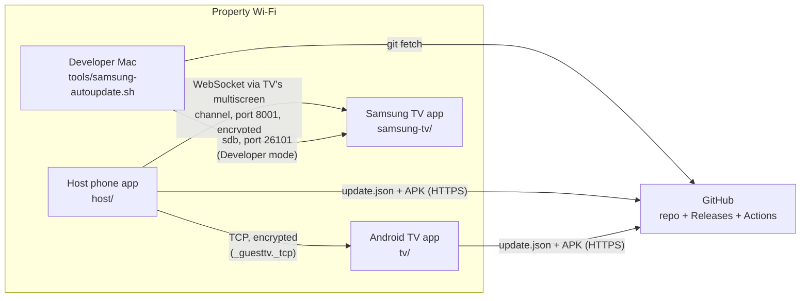
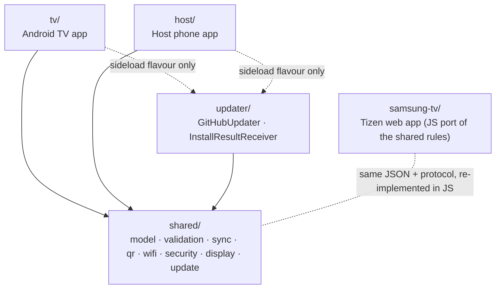

# Architecture

## System context

Everything talks over the property's Wi-Fi. Only two things touch the internet: GitHub (to publish
and fetch updates) and the developer's Mac (to push the Samsung app onto the TV).

## Modules

| Module | Responsibility | Key files |
|---|---|---|
| `shared` | The content model and every rule both apps must agree on. No Android code, so it's unit-tested on the JVM. | `model/PropertyContent.kt`, `model/ContentJson.kt`, `validation/ContentValidator.kt`, `validation/Validators.kt`, `sync/SyncProtocol.kt`, `sync/SyncCrypto.kt`, `sync/TvSyncServer.kt`, `sync/HostSyncClient.kt`, `sync/SamsungChannelDialer.kt`, `update/UpdateManifest.kt` |
| `tv` | Guest screen, PIN-protected Host Mode, first-run setup, screensaver, and the sync server it announces on the Wi-Fi. | `ui/guest/GuestScreen.kt`, `ui/host/HostScreen.kt`, `ui/onboarding/OnboardingScreen.kt`, `data/TvRepository.kt`, `data/SyncController.kt`, `di/AppContainer.kt`, `dream/GuestDreamService.kt` |
| `host` | Finds TVs, pairs, edits content, sends it. Shows the update banner. | `ui/HostViewModel.kt`, `ui/HostScreens.kt`, `data/TvDiscovery.kt`, `data/HostStore.kt`, `HostApp.kt` |
| `updater` | Checks GitHub Releases, downloads, verifies and installs an APK. | `GitHubUpdater.kt`, `InstallResultReceiver.kt` |
| `samsung-tv` | The same welcome design and protocol for Samsung, in browser JavaScript. | `index.html`, `style.css`, `app.js` (screens, remote keys), `content.js` (validation, text formatting), `sync.js` (pairing, encryption), `scene.js` (background art), `qr.js` (QR encoder), `config.xml` |
| `tools` | Samsung auto-installer, brand asset renderer. | `samsung-autoupdate.sh`, `install-samsung-autoupdate.sh`, `RenderBrandAssets.java` |
| Workflows | CI, Play bundles, sideload releases. | `.github/workflows/ci.yml`, `release.yml`, `sideload-release.yml` |

All Kotlin paths above are under `shared/src/main/kotlin/com/guestexperience/shared/`,
`tv/src/main/java/com/guestexperience/tv/`, `host/src/main/java/com/guestexperience/host/` and
`updater/src/main/java/com/guestexperience/updater/`.

## Where data lives

| Data | Android TV | Samsung TV | Phone |
|---|---|---|---|
| Content (`PropertyContent` JSON) | DataStore (`TvRepository`) | `localStorage` `guestWelcome.content.v2` | Not stored. Read from the TV (`get_content`), edited in memory, sent back |
| Wi-Fi password | Encrypted with an Android Keystore AES key (`SecretCipher`) | Plain in `localStorage` (Tizen has no keystore for web apps) | Not stored |
| Host PIN | Salted PBKDF2 hash only (`security/PinHasher.kt`) | No PIN; settings open from the ⚙ button | – |
| Pairing keys | Encrypted in DataStore | `localStorage` `guestWelcome.phones.v1` | One paired TV, key encrypted with a Keystore key (`HostStore`) |
| Custom background photo | App files (`ImageStore`); never leaves the TV | Not supported (falls back to the dusk scene) | – |

Backups are disabled on Android, so secrets never reach Google Drive.

## Tech stack

- Kotlin 2, Jetpack Compose (TV Material on `tv`, Material 3 on `host`), kotlinx.serialization, DataStore, ZXing (QR on Android).
- Min SDK 26. Target 35 (`tv`), 36 (`host`). Compile SDK 37.2.
- Samsung: Tizen 5.5 web runtime, plain ES5, WebCrypto, no libraries.
- Fonts: Cormorant Garamond (display) and Inter (text), SIL OFL (`licenses/`).

## Build flavours

| Flavour | For | Contains updater + `REQUEST_INSTALL_PACKAGES` | Built by |
|---|---|---|---|
| `play` | Google Play | No (Play policy) | `release.yml` on tag `v*` → signed AABs |
| `sideload` | Direct install from GitHub | Yes | `sideload-release.yml` on every push to `main` |

Flavour-specific code: `host/src/play|sideload/.../AppUpdatesFactory.kt` and the same in `tv/`.

## Security model

- Nothing listens on the Wi-Fi except the TV app while it is open.
- Pairing needs the 6-digit code on the TV screen (5-minute expiry, 5 attempts, single use).
- After pairing, every message is AES-256-GCM encrypted and carries an increasing counter (no replays).
- The TV validates everything it receives, regardless of what the phone checked.
- Updates are accepted only from this repo's releases over HTTPS, with a matching SHA-256, package name and signing key.

## Why it's built this way

| Decision | Why | Trade-off |
|---|---|---|
| Local network only, no cloud | No accounts, no servers to run, no guest data leaving the property | Host must be on the same Wi-Fi to edit |
| One JSON document (`PropertyContent`) | One thing to store, send, validate and (later) sync to a cloud | Must only ever add fields, with defaults |
| Shared rules in `shared/` | Phone and TV can't drift apart | Samsung needs a JS copy (`content.js`, `sync.js`) kept in step by hand |
| ECDH + 6-digit code | Secure pairing with nothing to type except the code | Active attacker during the 5-minute window could guess the code |
| Samsung uses the TV's multiscreen channel | Tizen web apps can't open a listening socket | Clients must not offer the `permessage-deflate` WebSocket extension |
| Own QR encoder in `qr.js` | No third-party code on the TV; verified against ZXing in `QrJsCompatTest` | Byte mode, level M, versions 1–15 only (enough for Wi-Fi) |
| `play` / `sideload` flavours | Play forbids self-updating; sideload users still get one-tap updates | Two build variants to test |
| Samsung updated from the Mac | Only this Mac holds the Samsung certificate, and the TV is in Developer mode | Mac must be on and on the same Wi-Fi |
| Sideload APKs signed with the Mac's **debug key** | Matches what was first installed, so updates install in place | **Weak.** Move to a real release key before handing out to other properties (see [EXTENDING.md](EXTENDING.md#scaling-roadmap)) |
