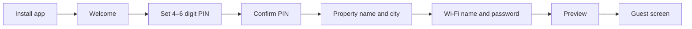
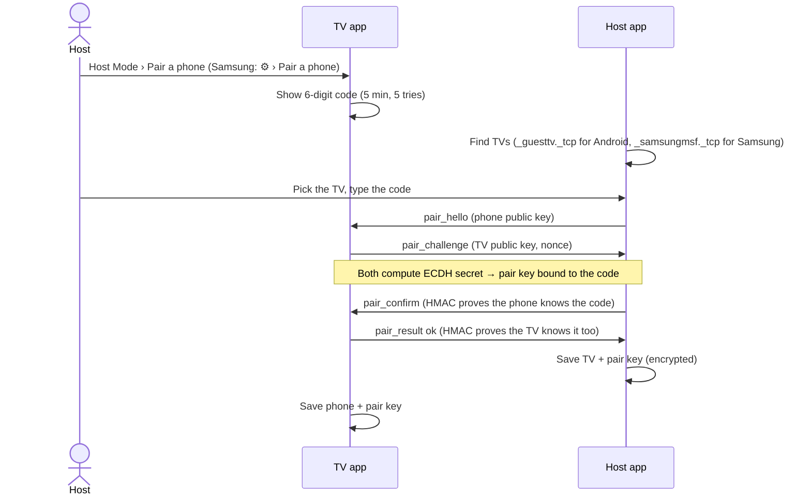
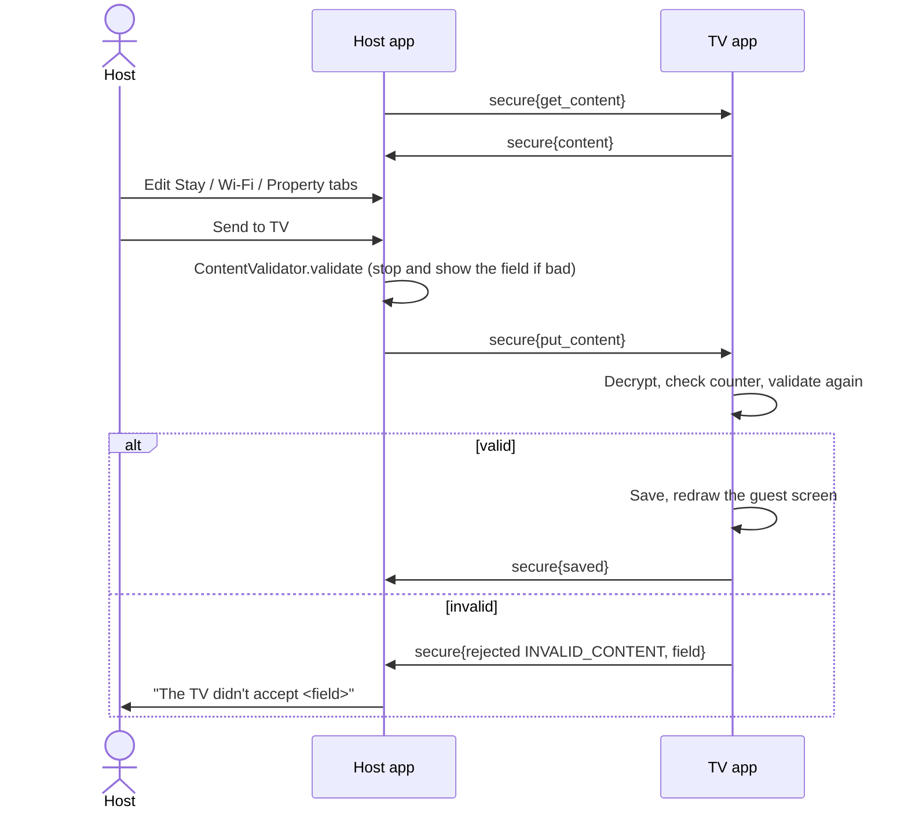
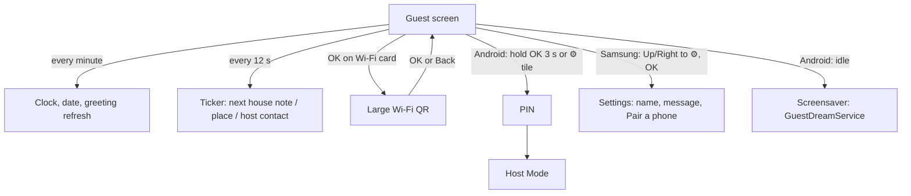
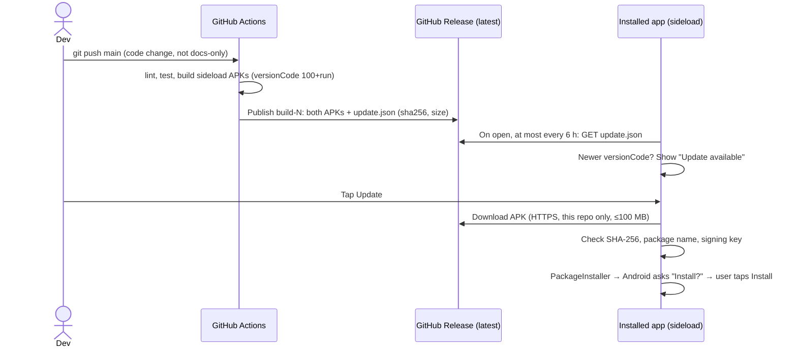
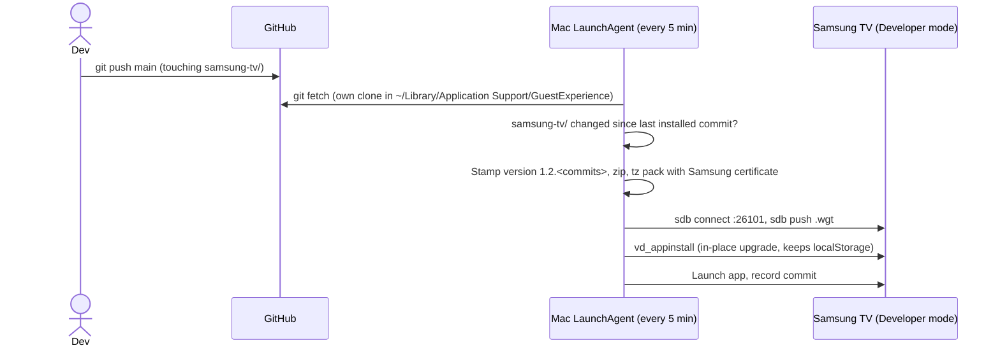

# Flows

## 1. First run on an Android TV

Code: `tv/.../ui/onboarding/OnboardingScreen.kt` (`OnboardingStep`). The Samsung app has no setup: it
opens on the welcome screen, and the host sets the name and message by remote or from the phone.

## 2. Pairing a phone with a TV (once per phone)

Transport differs, messages don't:
- **Android TV:** the phone opens a TCP connection to the port the TV announced (`TcpDialer`, `TvSyncServer`).
- **Samsung:** the phone opens a WebSocket to `ws://<tv>:8001/api/v2/channels/com.guestexperience.welcome`,
  starts the app if needed, and each message is an `ms.channel.emit` event named `guesttv`
  (`SamsungChannelDialer.kt` ↔ `samsung-tv/sync.js`).

## 3. Host edits the welcome and sends it

"Next guest" on the Stay tab clears the guest name, message and check-out, ready for the next booking.

## 4. What the guest sees

## 5. Update: Host phone app and Android TV app

Code: `.github/workflows/sideload-release.yml`, `updater/.../GitHubUpdater.kt`,
`shared/.../update/UpdateManifest.kt`. Android always needs that last tap for sideloaded apps.

## 6. Update: Samsung TV

Code: `tools/samsung-autoupdate.sh`. Log: `~/Library/Logs/GuestExperience/samsung-update.log`.
If the TV is off, it tries again on the next run.
