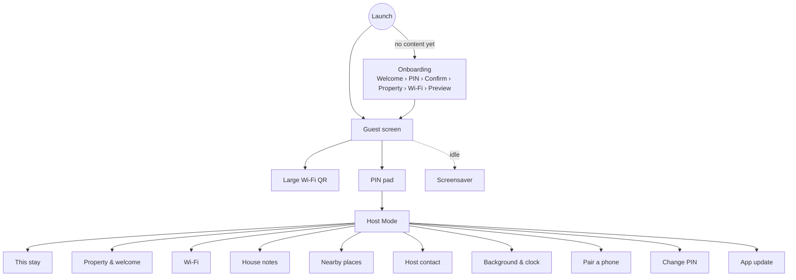
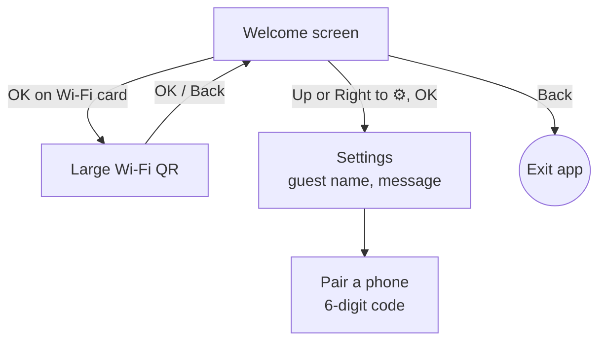
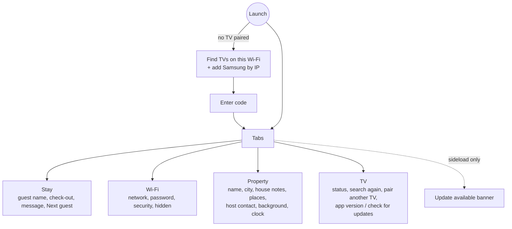

# Information architecture

## Android TV app (`tv/`)

Screens: `ui/guest/GuestScreen.kt`, `ui/host/PinScreen.kt`, `ui/host/HostScreen.kt` (`HostSection`),
`ui/onboarding/OnboardingScreen.kt`, `dream/GuestDreamService.kt`. Navigation state: `ui/AppViewModel.kt`
(`Screen { Guest, Pin, Host }`). "App update" only does something in sideload builds.

## Samsung TV app (`samsung-tv/`)

All screens are sections of `index.html`, switched by `app.js`. Anything beyond the name and message is
set from the phone.

## Host phone app (`host/`)

Code: `ui/HostScreens.kt` (`Tab`), `ui/HostViewModel.kt`. A **Send to TV** button sits under the Stay,
Wi-Fi and Property tabs. One phone is paired with one TV at a time.

## Guest screen layout (both TVs, 1920×1080)

| Area | Shows |
|---|---|
| Top left | Property name · city (small caps) |
| Top right | Clock, date, ⚙ settings button |
| Middle left | Greeting by time of day, "Welcome, {guest name}", host message |
| Bottom left | Check-out line, rotating ticker (house notes, places, host contact) |
| Bottom right | Wi-Fi card: QR, network name, password |
| Background | Udaipur dusk / night illustration, plain, or (Android only) the host's photo |

Empty fields are hidden, not shown blank. A 5% overscan margin keeps everything inside the visible area.

## Content model: `PropertyContent`

One JSON document (`shared/.../model/PropertyContent.kt`). Limits from `validation/Validators.kt`.

| Field | Type | Limit | Required | Shown |
|---|---|---|---|---|
| `schemaVersion` | int | – | auto (1) | – |
| `propertyName` | text | 60 | Android: yes · Samsung: no | Top left |
| `location` | text | 60 | no | Top left |
| `guestName` | text | 40 | no | Welcome line |
| `hostMessage` | text | 200 | no | Under the welcome |
| `wifi.ssid` | text | 32 bytes | Android: yes · Samsung: no | Wi-Fi card, QR |
| `wifi.password` | text | WPA 8–63 (or 64 hex), WEP 5/13 (or 10/26 hex), none if open | if SSID set | Wi-Fi card, QR |
| `wifi.security` | `WPA` / `WEP` / `OPEN` | – | default WPA | QR |
| `wifi.hidden` | bool | – | no | QR |
| `checkOut` | `{date: YYYY-MM-DD, time: HH:mm}` | – | no | Check-out line |
| `houseNotes` | list of text | 8 × 120 | no | Ticker |
| `places` | list of `{name 40, description 120}` | 8 | no | Ticker |
| `hostContact` | `{name 40, phone 24, note 120}` | – | no | Ticker |
| `background` | `{scene: udaipur_dusk / udaipur_night / plain, useCustomPhoto}` | – | default dusk | Background |
| `timeFormat` | `H12` / `H24` | – | default H12 | Clock |
| `updatedAt` | epoch ms | – | set by the TV | – |

The phone always checks the full Android rules before sending. The Samsung TV accepts a missing
property name and Wi-Fi so that older phone apps that send only the name and message still work.

## Remote control rules

| Key | Android TV guest screen | Samsung guest screen |
|---|---|---|
| D-pad | Moves between the Wi-Fi card and ⚙ tile | Up/Right → ⚙, Down/Left → Wi-Fi card |
| OK | Opens the focused item; hold 3 s → PIN | Opens the focused item |
| Back | Closes overlays | Closes overlays; exits the app on the welcome screen |

Every interactive element must be reachable with the D-pad and show a clear gold focus ring.
